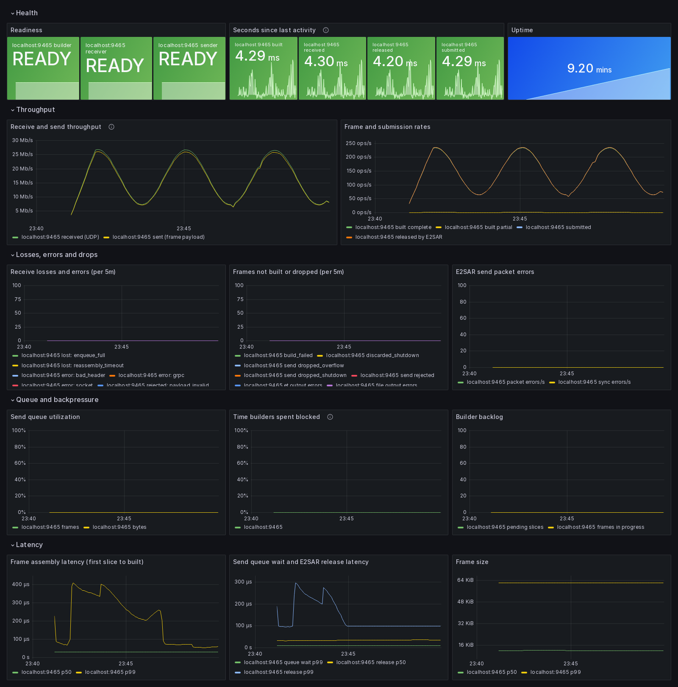

# coda-fb monitoring: Prometheus export and Grafana

**Status.** Option A below — the embedded `/metrics` endpoint — **is implemented**
(`src/metrics_endpoint.*`, `src/metrics_render.*`; enable with `--metrics-port`, see section 5)
and exports exactly the schema in section 2. The scrape configuration, alert rules and Grafana
dashboard in [`monitoring/`](monitoring/) are **examples**: they are checked (`promtool` and a
name cross-check against output scraped from the running binary) but nothing here assumes that
Prometheus or Grafana is deployed. The text-file fallback (option C) is not implemented.

## 1. How to expose the metrics

coda-fb is a single C++17 process, deployed as a container with host networking on DAQ hosts and
as a batch job (podman-hpc/Shifter) on Perlmutter. Its dependencies already include Boost 1.89
(from the E2SAR dependency bundle), which ships Boost.Beast as header-only HTTP on top of the
Boost.Asio that E2SAR already uses.

| | A. Embedded `/metrics` endpoint | B. Separate exporter reading structured stats | C. node_exporter textfile |
|---|---|---|---|
| How | A small HTTP listener thread in coda-fb renders `PipelineStats` + E2SAR stats in Prometheus text format on each scrape. | coda-fb emits machine-readable stats (JSON lines on stdout, a file, or a UNIX socket); a sidecar parses them and serves `/metrics`. | coda-fb atomically rewrites a `.prom` file every report interval; node_exporter on the host serves it. |
| Freshness | Exact values at scrape time. | One report interval old. | One report interval old. |
| New code / deps | ~300 lines, Boost.Beast (already available). No new library. | A structured output format (does not exist today) **plus** a second program to build, ship and keep in sync with field changes. | ~100 lines, no network code. |
| Deployment | Nothing extra; one port per instance (`--metrics-port`). Host networking means the port is on the host; must not collide when several instances share a node. | Second container/process per instance, or per host with discovery. | Needs node_exporter with `--collector.textfile.directory` on every host; file must be on a host path. |
| Failure isolation | A scrape runs on its own thread and only reads atomics; it cannot block the data path. A listener bug could still crash coda-fb. | Exporter crash cannot affect coda-fb. | Same as B. |
| Batch (Perlmutter) | Works if compute nodes are scrapeable from the Prometheus host, which is a site question. | Same reachability question, plus a sidecar in the job. | Usually no node_exporter on compute nodes. |

**Recommendation (implemented): A, an embedded endpoint**, disabled by default (`--metrics-port 0`) and bound to
a configurable address (`--metrics-bind`, default `127.0.0.1` so that enabling it never exposes
it beyond the host by accident). It gives exact values with no staleness, needs no new library,
and adds nothing to deploy. Rendering reads only the existing relaxed atomics and E2SAR's
`getStats()`/`getSendStats()`, so a scrape does not take any lock the data path uses.
Use `prometheus-cpp` instead only if its civetweb dependency is acceptable in the `e2sar-deps`
based image; it buys little over a hand-written text renderer for ~50 series.

Keep **C** as the fallback where a listening port is not allowed: the same renderer can write the
text to `<dir>/coda-fb.prom.tmp` and `rename()` it each interval. **B** is not recommended: it
would require inventing the structured format and a second component for no functional gain.

## 2. Metric schema

Conventions: prefix `coda_fb_`; counters end in `_total`; base units (`_bytes`, `_seconds`);
histograms in seconds/bytes. Labels come only from the small fixed sets below. **Never** labels
for frame or event numbers, data ids, URIs, tokens, or LB ids — `job`/`instance` (and any static
labels such as `role="fb"` or `lb_pair="hallb-1"`) are added by the scrape configuration.

Source: **E2SAR** = polled from E2SAR at scrape; **coda-fb** = `PipelineStats` (implemented).

### Receive (LB #1)

| Metric | Type | Labels | Source | Meaning |
|---|---|---|---|---|
| `coda_fb_recv_udp_packets_total` | counter | — | E2SAR | UDP packets received (`totalPackets`). |
| `coda_fb_recv_udp_bytes_total` | counter | — | E2SAR | UDP payload bytes received, incl. E2SAR headers (`totalBytes`). |
| `coda_fb_recv_events_reassembled_total` | counter | — | E2SAR | Events fully reassembled (`eventSuccess`; includes events then lost on enqueue). |
| `coda_fb_recv_events_lost_total` | counter | `reason`=`reassembly_timeout`\|`enqueue_full` | E2SAR | `reassemblyLoss`, `enqueueLoss`. |
| `coda_fb_recv_errors_total` | counter | `reason`=`bad_header`\|`socket`\|`grpc` | E2SAR | `badHeaderDiscards`, `dataErrCnt`, `grpcErrCnt`. |
| `coda_fb_recv_events_total` | counter | — | coda-fb | Events taken off E2SAR's queue (`recv.eventsReceived`). |
| `coda_fb_recv_event_bytes_total` | counter | — | coda-fb | Their payload bytes. |
| `coda_fb_recv_events_rejected_total` | counter | `reason`=`recv_error`\|`payload_invalid` | coda-fb | `recvErrors`, `payloadValidationErrors`. |
| `coda_fb_recv_events_byteswapped_total` | counter | — | coda-fb | `wrongEndianness` (kept, swapped). |

### Frame building

| Metric | Type | Labels | Meaning |
|---|---|---|---|
| `coda_fb_build_slices_total` | counter | — | Slices accepted by the builder. |
| `coda_fb_build_frames_total` | counter | `outcome`=`complete`\|`partial`\|`build_failed`\|`discarded_shutdown` | One increment per finalized frame. |
| `coda_fb_build_discarded_slices_total` | counter | — | Slices of frames discarded at shutdown. |
| `coda_fb_build_serialized_bytes_total` | counter | — | EVIO-6 bytes serialized. |
| `coda_fb_build_output_errors_total` | counter | `output`=`et`\|`file` | ET get/put and file open/write failures. |
| `coda_fb_build_pending_slices` | gauge | — | Slices waiting in builder FIFOs. |
| `coda_fb_build_frames_in_progress` | gauge | — | Corrected event numbers with slices waiting. |
| `coda_fb_build_frame_size_bytes` | histogram | — | Serialized frame size. Buckets 1 KiB, 4 KiB, 16 KiB, 64 KiB, 256 KiB, 1, 2, 4, 8, 16, 64 MiB. |
| `coda_fb_build_serialize_duration_seconds` | histogram | — | Time in `buildEVIO6Frame()`. |
| `coda_fb_build_assembly_duration_seconds` | histogram | — | First slice arrival → frame finalized (includes waiting for streams, up to `--frame-timeout`). |

Duration buckets (all histograms in seconds): 10 µs, 50 µs, 100 µs, 500 µs, 1, 5, 10, 50, 100,
500 ms, 1, 2.5, 5, 10 s — wide enough for microsecond serialization and second-scale frame
timeouts, 14 buckets per series.

### Forwarding (LB #2)

| Metric | Type | Labels | Source | Meaning |
|---|---|---|---|---|
| `coda_fb_send_frames_offered_total` | counter | — | coda-fb | Built frames handed to the sender. |
| `coda_fb_send_frames_total` | counter | `outcome`=`submitted`\|`dropped_overflow`\|`dropped_shutdown`\|`rejected` | coda-fb | Partition of offered. `submitted` = accepted by E2SAR's queue (local only). |
| `coda_fb_send_frames_released_total` | counter | — | coda-fb | E2SAR finished sending (callback). Not delivery. |
| `coda_fb_send_partial_frames_skipped_total` | counter | — | coda-fb | `--send-partial-frames=0`. |
| `coda_fb_send_bytes_total` | counter | `stage`=`submitted`\|`released` | coda-fb | Frame bytes (payload; excludes LB/RE/UDP/IP headers). |
| `coda_fb_send_submit_retries_total` | counter | — | coda-fb | E2SAR queue momentarily full. |
| `coda_fb_send_blocked_seconds_total` | counter | — | coda-fb | Time builders spent waiting for in-flight space (sum over threads). |
| `coda_fb_send_blocked_submits_total` | counter | — | coda-fb | Submits that had to wait. |
| `coda_fb_send_inflight_frames` / `_bytes` | gauge | — | coda-fb | Currently in flight. |
| `coda_fb_send_capacity_frames` / `_bytes` | gauge | — | coda-fb | `--send-queue-frames` / `--send-queue-bytes`. |
| `coda_fb_send_abandoned_frames` | gauge | — | coda-fb | In flight at the drain deadline (set at shutdown). |
| `coda_fb_send_queue_wait_seconds` | histogram | — | coda-fb | Offered → submitted. |
| `coda_fb_send_release_latency_seconds` | histogram | — | coda-fb | Submitted → released. |
| `coda_fb_send_packets_total` | counter | — | E2SAR | `msgCnt`. With the default `sendmsg` path this counts attempts; with the `sendmmsg` optimization, successes. |
| `coda_fb_send_packet_errors_total` | counter | — | E2SAR | `errCnt`. The only signal of send failure (no per-frame status in E2SAR 0.4.0rc1). |
| `coda_fb_send_packets_estimated_total` | counter | — | coda-fb | ESTIMATE `Σ ceil(bytes / payload per packet)`. |
| `coda_fb_send_sync_messages_total` / `coda_fb_send_sync_errors_total` | counter | — | E2SAR | Sync packets to LB #2. |

### Health

| Metric | Type | Labels | Meaning |
|---|---|---|---|
| `coda_fb_ready` | gauge 0/1 | `stage`=`receiver`\|`builder`\|`sender` | Stage initialized and running. Absent stage (e.g. sender not enabled) is not exported. |
| `coda_fb_start_time_seconds` | gauge | — | Unix time of process start. |
| `coda_fb_last_activity_timestamp_seconds` | gauge | `stage`=`received`\|`built`\|`submitted`\|`released` | Unix time of the last event at that stage; not exported until it happened. Internally monotonic; converted to wall clock at scrape. |
| `coda_fb_build_info` | gauge = 1 | `version`, `e2sar_version` | Build identification. |

**Not exported, on purpose:** downstream delivery (nothing measures it; LB #2's control plane
statistics via `LBManager::getLBStatus()` would be a separate, LB-side source), bytes on the wire
(E2SAR does not expose them), per-stream or per-frame series (unbounded cardinality).

## 3. Rates, throughput and restarts in PromQL

Counters are cumulative from process start and reset to zero when coda-fb restarts (every new run
is a new process). `rate()`/`increase()` detect a counter decrease as a reset and compensate, so
always use them rather than subtracting raw values. Restarts themselves are visible as
`changes(coda_fb_start_time_seconds[1h])` or `resets(coda_fb_recv_events_total[1h])`. Use a
`rate()` window of at least 4 scrape intervals.

| Question | PromQL |
|---|---|
| Receive throughput (bits/s) | `rate(coda_fb_recv_udp_bytes_total[1m]) * 8` |
| Send throughput (frame bits/s) | `rate(coda_fb_send_bytes_total{stage="released"}[1m]) * 8` |
| Frame completion rate | `sum by (instance) (rate(coda_fb_build_frames_total{outcome=~"complete\|partial"}[1m]))` |
| Share of partial frames | `rate(coda_fb_build_frames_total{outcome="partial"}[5m]) / ignoring(outcome) sum without(outcome) (rate(coda_fb_build_frames_total{outcome=~"complete\|partial"}[5m]))` |
| Submission rate | `rate(coda_fb_send_frames_total{outcome="submitted"}[1m])` |
| Reassembly losses | `sum by (instance, reason) (increase(coda_fb_recv_events_lost_total[5m]))` |
| Send failures | `rate(coda_fb_send_packet_errors_total[5m])`, `increase(coda_fb_send_frames_total{outcome="rejected"}[5m])` |
| Dropped frames | `sum by (instance, outcome) (increase(coda_fb_send_frames_total{outcome=~"dropped_.*"}[5m]))` |
| Queue utilization | `coda_fb_send_inflight_frames / coda_fb_send_capacity_frames` (and `_bytes`) |
| Backpressure (fraction of time blocked) | `rate(coda_fb_send_blocked_seconds_total[1m])` — per builder thread-second; can exceed 1 with several builder threads |
| Assembly latency p99 | `histogram_quantile(0.99, sum by (instance, le) (rate(coda_fb_build_assembly_duration_seconds_bucket[5m])))` |
| Queue wait p99 | `histogram_quantile(0.99, sum by (instance, le) (rate(coda_fb_send_queue_wait_seconds_bucket[5m])))` |
| Frame size p50 | `histogram_quantile(0.5, sum by (instance, le) (rate(coda_fb_build_frame_size_bytes_bucket[5m])))` |
| Not ready | `min by (instance) (coda_fb_ready) == 0` |
| Seconds since a stage last did something | `timestamp(coda_fb_last_activity_timestamp_seconds) - coda_fb_last_activity_timestamp_seconds` (measured at the scrape; `time() - ...` would add up to one scrape interval) |
| Receiving but not building | `rate(coda_fb_recv_events_total[2m]) > 0 and on (instance) (timestamp(coda_fb_last_activity_timestamp_seconds{stage="built"}) - coda_fb_last_activity_timestamp_seconds{stage="built"}) > 30` |

## 4. Prometheus, alerts and Grafana

- [`monitoring/prometheus.yml`](monitoring/prometheus.yml): scrape configuration (static targets
  and file-based discovery for batch nodes).
- [`monitoring/coda-fb-alerts.yml`](monitoring/coda-fb-alerts.yml): alert rules — sustained queue
  saturation, growing losses/errors/drops, instance down or not ready, and no progress while
  traffic is expected.
- [`monitoring/stack/`](monitoring/stack/): Docker Compose deployment of Prometheus and Grafana
  with the data source and dashboard provisioned — see section 6.
- [`monitoring/grafana-dashboard.json`](monitoring/grafana-dashboard.json): dashboard with a
  Prometheus datasource variable and an `instance` selector; panels for receive/send throughput,
  frame and submission rates, losses/errors/drops, queue utilization and backpressure, latency
  percentiles, readiness and time since last activity.

Thresholds in the alerts are starting points: tune `for:` durations and limits to the run
conditions (beam on/off, expected rates). "No progress" alerts should be gated on traffic being
expected — either by the `rate(...) > 0` conditions used here or by silencing during beam-off.

## 5. Running it

### 5.1 Enabling the endpoint

The endpoint is off unless `--metrics-port` is given.

| Option | Default | Meaning |
|---|---|---|
| `--metrics-port N` | `0` (off) | TCP port for `http://<bind>:N/metrics`. `9465` is used in the examples; any free port works. |
| `--metrics-bind ADDR` | `127.0.0.1` | Listen address. The default answers only on this host. Use `0.0.0.0` (all interfaces) or the host's address when Prometheus runs on another machine. IPv6 addresses work too (e.g. `::`). |

Local only — scrape from the same host, e.g. a node-local Prometheus agent or `curl`:

```bash
coda-fb --recv-ejfat-uri "$LB1_URI" --ip 10.0.0.5 --threads 4 \
        --enable-framebuild=1 --expected-streams 3 --fb-output-dir /data/frames \
        --metrics-port 9465
```

Reachable from a central Prometheus, with forwarding to a second LB:

```bash
coda-fb --recv-ejfat-uri "$LB1_URI" --send-ejfat-uri "$LB2_URI" \
        --ip 10.0.0.5 --threads 4 --enable-framebuild=1 --expected-streams 3 \
        --metrics-port 9465 --metrics-bind 0.0.0.0
```

Bind to one interface only (recommended on multi-homed DAQ hosts — pick the management network,
not the data network):

```bash
coda-fb ... --metrics-port 9465 --metrics-bind 192.168.10.5
```

**Several instances on one host** each need their own port (`9465`, `9466`, ...), and every
port needs its own scrape target. With host networking in the container the port is on the host.

**Container.** The entrypoint maps `METRICS_PORT` and `METRICS_BIND` to the two options:

```bash
docker run -d --name coda-fb --network host -v /data/frames:/data \
  -e RECV_EJFAT_URI="$LB1_URI" -e SEND_EJFAT_URI="$LB2_URI" \
  -e RECEIVER_IP=10.0.0.5 -e THREADS=4 -e EXPECTED_STREAMS=3 \
  -e METRICS_PORT=9465 -e METRICS_BIND=0.0.0.0 \
  coda-fb:v1.0.0
```

or in `coda-fb.env`: `METRICS_PORT=9465` and `METRICS_BIND=0.0.0.0`.

**Batch jobs (Perlmutter).** The node is only known at run time. Have the job publish itself to
a `file_sd_configs` directory that Prometheus watches (see `monitoring/prometheus.yml`), and
remove the file when the job ends:

```bash
TARGETS=/global/cfs/cdirs/<project>/prometheus-targets   # watched by Prometheus
echo "[{\"targets\": [\"$(hostname):9465\"], \"labels\": {\"slurm_job\": \"$SLURM_JOB_ID\"}}]" \
    > "$TARGETS/coda-fb-$SLURM_JOB_ID.json"
trap 'rm -f "$TARGETS/coda-fb-$SLURM_JOB_ID.json"' EXIT

podman-hpc run --rm --net host ... -e METRICS_PORT=9465 -e METRICS_BIND=0.0.0.0 "$IMAGE"
```

Whether a compute node can be reached from the Prometheus host is a site networking question;
check it before relying on this.

### 5.2 Checking that it works

At startup coda-fb prints the URL right after its version banner, before any LB registration:

```
CODA Frame Builder v1.0.0
Using E2SAR library v0.4.0rc1
=========================================
Prometheus metrics: http://0.0.0.0:9465/metrics
```

and at exit, during final cleanup:

```
Metrics endpoint stopped after 1234 scrapes
```

Scrape it by hand:

```bash
curl -s http://localhost:9465/metrics | head
curl -s http://localhost:9465/metrics | grep -E '^coda_fb_(ready|send_frames_total)'
curl -si http://localhost:9465/metrics | head -4      # status line and Content-Type
```

An excerpt of a real scrape (from the end-to-end test, 40 frames forwarded):

```
# HELP coda_fb_ready 1 once the stage is initialized and running, 0 before that and during shutdown.
# TYPE coda_fb_ready gauge
coda_fb_ready{stage="receiver"} 1
coda_fb_ready{stage="builder"} 1
coda_fb_ready{stage="sender"} 1
# HELP coda_fb_send_frames_total Offered frames by outcome. submitted means accepted by the local E2SAR queue, not delivered.
# TYPE coda_fb_send_frames_total counter
coda_fb_send_frames_total{outcome="submitted"} 40
coda_fb_send_frames_total{outcome="dropped_overflow"} 0
coda_fb_send_frames_total{outcome="dropped_shutdown"} 0
coda_fb_send_frames_total{outcome="rejected"} 0
# HELP coda_fb_send_queue_wait_seconds Time from a frame being offered to being submitted.
# TYPE coda_fb_send_queue_wait_seconds histogram
coda_fb_send_queue_wait_seconds_bucket{le="1e-05"} 39
coda_fb_send_queue_wait_seconds_bucket{le="5e-05"} 39
coda_fb_send_queue_wait_seconds_bucket{le="0.0001"} 39
coda_fb_send_queue_wait_seconds_bucket{le="0.0005"} 40
...
coda_fb_send_queue_wait_seconds_bucket{le="+Inf"} 40
coda_fb_send_queue_wait_seconds_sum 0.000265166
coda_fb_send_queue_wait_seconds_count 40
```

Lint the output with Prometheus' own checker (no Prometheus server needed):

```bash
curl -s http://localhost:9465/metrics | promtool check metrics
# or, without installing promtool:
curl -s http://localhost:9465/metrics | \
    docker run --rm -i --entrypoint promtool prom/prometheus:v2.53.0 check metrics
```

HTTP behavior: `GET /metrics` → `200`; `GET /` → `200` with a pointer to `/metrics`; any other
path → `404`; any method other than `GET` → `405`; an error while rendering → `500`.

| Symptom | Cause |
|---|---|
| `ERROR: cannot listen for metrics on 127.0.0.1:9465: Address already in use` and exit | Port taken (another instance?). Nothing was registered with any LB. |
| `ERROR: invalid --metrics-bind address '...'` | Not an IP address (host names are not accepted). |
| `curl` works on the host, Prometheus target is down | Still bound to `127.0.0.1`; set `--metrics-bind`. Or a firewall. |
| `coda_fb_recv_udp_packets_total` and other E2SAR families missing | Startup has not finished (receiver not up yet). They appear once it has. |
| No `coda_fb_build_*` / `coda_fb_send_*` families | Frame building / forwarding not enabled in this run. |

## 6. Running with Prometheus and Grafana

### 6.1 The monitoring stack

[`monitoring/stack/`](monitoring/stack/) is a ready-to-run Prometheus + Grafana deployment for
coda-fb. Grafana is provisioned at startup with the Prometheus data source and the coda-fb
dashboard, so nothing has to be clicked together.

| File | Purpose |
|---|---|
| `docker-compose.yml` | Prometheus 2.53 on `:9090` and Grafana 11.1 on `:3000`, host networking, named volumes for stored metrics (30 days) and Grafana state. |
| `prometheus.yml` | Scrape configuration: **edit the target list**. Loads `../coda-fb-alerts.yml`. 5 s scrape interval. |
| `grafana/provisioning/datasources/prometheus.yml` | Data source `Prometheus` → `http://localhost:9090`, default. |
| `grafana/provisioning/dashboards/coda-fb.yml` | Loads `../grafana-dashboard.json` into a `coda-fb` folder; it is also Grafana's home page. |

On a Linux host that can reach the coda-fb hosts:

```bash
# 1. coda-fb on each DAQ host, reachable from the monitoring host
coda-fb --recv-ejfat-uri "$LB1_URI" --send-ejfat-uri "$LB2_URI" ... \
        --metrics-port 9465 --metrics-bind 0.0.0.0

# 2. on the monitoring host
cd doc/monitoring/stack
$EDITOR prometheus.yml                 # targets: ['daq-fb1:9465', 'daq-fb2:9465', ...]
GRAFANA_ADMIN_PASSWORD='choose-one' docker compose up -d

# 3. check
curl -s localhost:9090/api/v1/targets | grep -o '"health":"[a-z]*"'   # "up" per coda-fb
```

Then:

- **Prometheus** — `http://<monitoring-host>:9090`: *Status → Targets* lists every coda-fb as
  `UP`; *Alerts* shows the 11 coda-fb rules (inactive while everything is healthy); *Graph* runs
  any query from section 3.
- **Grafana** — `http://<monitoring-host>:3000`, user `admin`, password as set above (default
  `admin`, which Grafana asks you to change). The home page is the **coda-fb pipeline**
  dashboard; pick instances in the *Instance* selector at the top.

Stop with `docker compose down` (stored metrics are kept in the volumes; `down -v` deletes them).
After editing `prometheus.yml` or the alert rules: `docker compose restart prometheus`. After
editing the dashboard JSON: `docker compose restart grafana` (changes made in the Grafana UI are
allowed but are lost on restart unless exported back into `grafana-dashboard.json`).

**Notes**

- *Alert notifications.* Alerts are evaluated by Prometheus and shown in its UI, but nothing is
  notified: no Alertmanager is included. Add one and an `alerting:` section in `prometheus.yml`
  to send e-mail/Slack/etc.
- *Docker Desktop (macOS/Windows).* Host networking there does not publish ports to the desktop.
  Use bridge networking instead: in `docker-compose.yml` replace `network_mode: host` with
  `ports: ["9090:9090"]` (Prometheus) and `ports: ["3000:3000"]` (Grafana), set the data source
  URL to `http://prometheus:9090`, and scrape a coda-fb running on the desktop itself as
  `host.docker.internal:9465`.
- *Existing Prometheus/Grafana.* Instead of the stack, add the `coda-fb` job from
  `monitoring/prometheus.yml` and `rule_files: [coda-fb-alerts.yml]` to your Prometheus, and in
  Grafana use *Dashboards → New → Import*, upload `monitoring/grafana-dashboard.json`, and select
  your Prometheus data source.
- *Security.* Neither coda-fb's endpoint nor this stack is meant for untrusted networks: change
  the Grafana password, and restrict ports 9090, 3000 and 9465 with the host firewall.

### 6.2 Demo without EJFAT

To see the dashboard with live data and no load balancer, run coda-fb on loopback between a
traffic generator and a stand-in for the second LB. `test/loopback_traffic` is both: it sends
ROC slices to coda-fb with an E2SAR segmenter, and drains what coda-fb forwards with an E2SAR
reassembler. The control plane is off on both sides (`--withcp=0`, `--send-nocp`), so the URIs
only supply data addresses and their tokens are placeholders.

```bash
# build (tests and tools are not built by default)
meson compile -C builddir coda-fb loopback_traffic

# terminal 1: coda-fb, receiving on :21000, forwarding to :22000, metrics on :9465
./builddir/coda-fb \
    --recv-ejfat-uri 'ejfat://demo@127.0.0.1:18347/lb/1?data=127.0.0.1' --withcp=0 \
    --ip 127.0.0.1 --port 21000 --threads 1 --bufsize 200000 \
    --enable-framebuild=1 --expected-streams 3 --frame-timeout 200 \
    --send-ejfat-uri 'ejfat://demo@127.0.0.2:18347/lb/2?data=127.0.0.1:22000' --send-nocp \
    --send-warmup 0 --send-bufsize 200000 --send-queue-frames 64 \
    --metrics-port 9465

# terminal 2: 3 ROC streams for 25 minutes
./builddir/test/loopback_traffic --streams 3 --seconds 1500 --min-hz 50 --max-hz 250 --period 180

# terminal 3: the stack (prometheus.yml already targets localhost:9465)
cd doc/monitoring/stack && docker compose up -d
```

The generator varies the frame rate along a sine between 50 and 250 frames/s with a 3-minute
period, sends 1–8 KiB per slice, and leaves out one stream every 200th frame; with
`--frame-timeout 200` those frames are built as partial frames after 200 ms. It prints its
progress every 10 s (`frames=` sent upstream, `drained=` received back downstream). Give the
graphs 5–10 minutes: the rate panels use 1–5 minute windows. The socket buffers are kept at
200 kB to fit Linux's default `net.core.[rw]mem_max`; at higher rates raise those sysctls and the
`--bufsize`/`--send-bufsize` options together.

#### Running the demo with the Docker image

The same demo on a host that runs coda-fb from the Docker image (README, "Docker: build, ship
and run on a remote node"), from the top of a coda-fb checkout. The runtime image carries only
`coda-fb`, so the traffic generator is compiled once in the image's `build` stage, which Docker
has cached from the image build. Run it in the checkout where `docker/build.sh` ran, so the
E2SAR deps bundle it fetched (`docker/e2sar-deps_<ver>_amd64.deb`) is in the build context.
Replace `coda-fb:v1.1.0` with your tag.

```bash
# 0. once: an image with the build tree and the traffic generator compiled in it
docker build --target build -t coda-fb:build -f docker/Dockerfile .
docker run --name lbgen-build coda-fb:build \
    meson compile -C /src/coda-fb/builddir loopback_traffic
docker commit lbgen-build coda-fb:loopback && docker rm lbgen-build

# 1. coda-fb: receiving on :21000, forwarding to :22000, metrics on :9465
docker run -d --name coda-fb --network host coda-fb:v1.1.0 \
    --recv-ejfat-uri 'ejfat://demo@127.0.0.1:18347/lb/1?data=127.0.0.1' --withcp=0 \
    --ip 127.0.0.1 --port 21000 --threads 1 --bufsize 200000 \
    --enable-framebuild=1 --expected-streams 3 --frame-timeout 200 \
    --send-ejfat-uri 'ejfat://demo@127.0.0.2:18347/lb/2?data=127.0.0.1:22000' --send-nocp \
    --send-warmup 0 --send-bufsize 200000 --send-queue-frames 64 \
    --metrics-port 9465

# 2. simulated data: 3 ROC streams for 25 minutes, and the downstream drain
docker run -d --name lbgen --network host coda-fb:loopback \
    /src/coda-fb/builddir/test/loopback_traffic --streams 3 --seconds 1500 \
    --min-hz 50 --max-hz 250 --period 180

# 3. the stack (prometheus.yml already targets localhost:9465)
cd doc/monitoring/stack && docker compose up -d
```

Check that data flows, then open the dashboard from your workstation through an SSH tunnel
(Grafana `admin`/`admin`, dashboard **coda-fb pipeline**):

```bash
curl -s localhost:9465/metrics | grep coda_fb_build_frames   # counters increase
docker logs -f lbgen                                         # frames= / drained= every 10 s

# on your workstation
ssh -L 3000:localhost:3000 -L 9090:localhost:9090 <remote-host>   # then http://localhost:3000
```

`docker stop lbgen` stops the input: the rate panels drop to zero at once, and `CodaFbNoInput` fires after about
15 minutes (5-minute rate window plus `for: 10m`);
a small `--send-queue-frames` (e.g. 4) exercises the forwarding queue panels. Clean up with
`docker rm -f coda-fb lbgen` and `docker compose down -v` in `doc/monitoring/stack`.

The containers use host networking, so ports 21000, 22000, 9465, 9090 and 3000 must be free on
the host. If the image was built elsewhere and shipped, run step 0 on the build machine and ship
`coda-fb:loopback` the same way; the host still needs `doc/monitoring/` for step 3.

### 6.3 The dashboard



*The **coda-fb pipeline** dashboard during the demo of section 6.2, last 10 minutes: one
coda-fb, 3 streams, forwarding enabled.*

Reading it top to bottom answers: is it up, is data flowing, is anything lost, is it keeping up,
how fast is it.

| Row | Panels | In the screenshot |
|---|---|---|
| **Health** | *Readiness* per stage (green READY / red NOT READY). *Seconds since last activity* for received, built, submitted, released — measured at the scrape, with a sparkline; turns orange above 5 s and red above 30 s. *Uptime*. | All three stages READY; every stage active within ~4 ms of the latest scrape; up 9 minutes. |
| **Throughput** | *Receive and send throughput* in bits/s: UDP received from LB #1 vs frame bytes released towards LB #2. *Frame and submission rates*: built complete / built partial / submitted / released, frames/s. | Both curves follow the generator's 3-minute sine, 7–26 Mb/s. Received is slightly above sent (E2SAR headers, and the CODA block header dropped from each slice). Complete, submitted and released overlap at 60–235 frames/s; partial frames sit just above 0 (one in 200). |
| **Losses, errors and drops** | Receive losses by reason and receive errors; frames that failed to build, were discarded or dropped/rejected by the sender, ET/file output errors (per 5 min); E2SAR packet and sync send errors per second. | All flat at 0: no losses, drops or errors. |
| **Queue and backpressure** | *Send queue utilization* (in-flight frames and bytes / capacity); *Time builders spent blocked*; *Builder backlog* (pending slices, frames in progress). | All ≈0: frames are released by E2SAR long before the 64-frame limit, builders never block. A rising utilization, blocked time or backlog is the early sign that forwarding cannot keep up. |
| **Latency** | Frame assembly p50/p99 (first slice → built); send queue wait p99 and E2SAR release p50/p99; frame size p50/p99. | Assembly p50 ≈30 µs, p99 60–400 µs; queue wait ≈10 µs, release ≈35 µs (p50) to 100–300 µs (p99); frames 12–62 KiB. |

The *Instance* selector at the top (hidden in the kiosk-mode screenshot) chooses which coda-fb
instances are shown; with several, every panel shows one series per instance.

Quantiles are estimated from histogram buckets, so a flat line at a bucket boundary (e.g. the
64 KiB frame-size p99) means "the values lie in that bucket", not an exact value.

### 6.4 Capturing the dashboard as an image

The screenshot above was taken from the demo with headless Chrome. Grafana needs a login, so
for the capture only, enable anonymous read-only access with a Compose override (do not leave
this on a shared host):

```bash
cat > /tmp/grafana-anonymous.yml <<'EOF'
services:
  grafana:
    environment:
      GF_AUTH_ANONYMOUS_ENABLED: "true"
      GF_AUTH_ANONYMOUS_ORG_ROLE: Viewer
EOF
cd doc/monitoring/stack
docker compose -f docker-compose.yml -f /tmp/grafana-anonymous.yml up -d grafana

docker run --rm --network host -v "$PWD":/out zenika/alpine-chrome:124 \
    --no-sandbox --disable-gpu --hide-scrollbars --window-size=1600,2700 --virtual-time-budget=20000 \
    --screenshot=/out/dashboard.png \
    'http://localhost:3000/d/coda-fb-pipeline/coda-fb-pipeline?orgId=1&from=now-15m&to=now&kiosk'

docker compose up -d grafana     # back to login required
```

`kiosk` hides Grafana's menus; `from`/`to` select the time range.

### 6.5 Monitoring a coda-fb running on a remote host

Recommended layout: run the stack **on the same remote host** as coda-fb, keep every port bound
to localhost, and look at Grafana from your own machine through an SSH tunnel. Nothing is exposed
on the network, and your machine needs only `ssh` and a browser.

```
your laptop                         remote DAQ host
browser ── ssh -L 3000 ──────────►  Grafana  127.0.0.1:3000
                                      └─► Prometheus 127.0.0.1:9090
                                            └─► coda-fb /metrics 127.0.0.1:9465
```

1. **Build the image** on an x86_64 Linux machine (see `docker/README.md`; a QEMU build on Apple
   Silicon is impractically slow) and ship it:

   ```bash
   ./docker/build.sh --tag coda-fb:v1.1.0 --save coda-fb-v1.1.0.tar.gz
   scp coda-fb-v1.1.0.tar.gz daq-host:/tmp/
   ssh daq-host 'gunzip -c /tmp/coda-fb-v1.1.0.tar.gz | docker load'
   ```

   or `--push <registry-user>` and `docker pull` on the host. The image is built from the
   working tree (`docker build` context is the repository root), so uncommitted changes are
   included.

2. **Copy the monitoring files** — the whole `doc/monitoring/` directory, because the stack
   refers to `../coda-fb-alerts.yml` and `../grafana-dashboard.json`:

   ```bash
   scp -r doc/monitoring daq-host:~/coda-fb-monitoring
   ```

   If the host cannot pull from Docker Hub, ship the two images as well:
   `docker save prom/prometheus:v2.53.0 grafana/grafana:11.1.0 | gzip > monitoring-images.tar.gz`.

3. **Run coda-fb** on the host with the endpoint on localhost (the default bind):

   ```bash
   docker run -d --name coda-fb --network host -v /data/frames:/data \
     -e RECV_EJFAT_URI="$LB1_URI" -e SEND_EJFAT_URI="$LB2_URI" \
     -e RECEIVER_IP=10.0.0.5 -e THREADS=4 -e EXPECTED_STREAMS=3 \
     -e METRICS_PORT=9465 \
     coda-fb:v1.1.0
   curl -s localhost:9465/metrics | grep coda_fb_ready    # on the host
   ```

   (with `docker/docker-compose.yml`, put `METRICS_PORT=9465` in `coda-fb.env`.)

4. **Start the stack** on the host, listening on localhost only:

   ```bash
   cd ~/coda-fb-monitoring/stack          # prometheus.yml already targets localhost:9465
   PROMETHEUS_LISTEN=127.0.0.1:9090 GRAFANA_LISTEN_ADDR=127.0.0.1 \
   GRAFANA_ADMIN_PASSWORD='choose-one' docker compose up -d
   ```

5. **Open the tunnel** from your machine and browse:

   ```bash
   ssh -N -L 3000:localhost:3000 -L 9090:localhost:9090 user@daq-host
   # through a gateway:  ssh -N -J user@gateway -L 3000:localhost:3000 -L 9090:localhost:9090 user@daq-host
   ```

   <http://localhost:3000>: log in as `admin` with the `GRAFANA_ADMIN_PASSWORD` from step 4; the
   home page is the **coda-fb pipeline** dashboard (it refreshes every 10 s;
   choose the time range top right). <http://localhost:9090> is Prometheus (targets, alerts,
   ad-hoc queries). If port 3000 or 9090 is busy on your laptop, tunnel another local port, e.g.
   `-L 13000:localhost:3000`.

The stack keeps running and recording when you close the tunnel, so history is there the next
time you connect; Prometheus keeps 30 days.

**Several coda-fb hosts.** Run the stack once, on a monitoring host, and point it at all of them:
start each coda-fb with `METRICS_BIND` set to an address the monitoring host can reach (ideally
a management interface, not the data network), allow only the monitoring host to reach port
9465 in the firewall, list the hosts in `stack/prometheus.yml`, and tunnel to the monitoring
host as above. The *Instance* selector on the dashboard switches between them.

**Perlmutter.** Compute nodes run podman-hpc, not this stack, and are usually not reachable from
outside. Run the stack somewhere that can reach the node (if any), publish the node with the
`file_sd` snippet from section 5.1, and confirm the network path with NERSC first.

## 7. Implementation details

### 7.1 Components

| Piece | Role |
|---|---|
| `src/pipeline_stats.hpp` | The statistics themselves: lock-free counters, gauges, event times and fixed-bucket histograms, updated by the data path (unchanged by the endpoint). |
| `src/metrics_render.{hpp,cpp}` | `renderPrometheus(const MetricsSources&)`: a pure function from a snapshot to exposition format 0.0.4. `MetricsSources` holds a pointer to `PipelineStats`, plain copies of E2SAR's counters (`E2SARReceiveSnapshot`, `E2SARSendSnapshot`, each optional), which stages are enabled, version strings and the current monotonic and wall clocks. No network and no E2SAR dependency, so it is unit-tested directly. |
| `src/metrics_endpoint.{hpp,cpp}` | `MetricsEndpoint`: an HTTP/1.1 server (Boost.Beast over Boost.Asio) that calls a render callback for each `GET /metrics`. Beast is used only in this `.cpp` (pimpl), so nothing else pays its compile time. Knows nothing about coda-fb's statistics. |
| `renderMetrics()` in `src/coda-fb.cpp` | The render callback: copies E2SAR's `Reassembler::getStats()`, `Segmenter::getSendStats()` and `getSyncStats()` into the snapshot, stamps the clocks and calls `renderPrometheus()`. |

### 7.2 Serving requests

- One background thread runs a single-threaded `io_context`. The acceptor accepts asynchronously;
  each connection is a `Session` that reads one request, writes one response with
  `Connection: close`, and closes.
- Every read and write has a 5 s deadline (`beast::tcp_stream::expires_after`), so a client that
  connects and never sends anything is disconnected and cannot hold the server. Because all I/O
  is asynchronous, other scrapes are served while such a client is pending.
- Requests are limited by Beast's defaults (8 KiB header, 1 MiB body). The query string is
  ignored (`/metrics?x=1` works).
- Rendering happens on the endpoint thread, so a scrape never runs on a data-path thread. If the
  callback throws, the client gets a `500` with the message and the server keeps running.
- No keep-alive, compression, TLS or authentication: one scrape every few seconds does not need
  them, and access is controlled by `--metrics-bind` (see 6.6).

### 7.3 Concurrency and the E2SAR objects

coda-fb's own statistics are atomics and can be read at any time. E2SAR's statistics come from
objects that are created during startup and destroyed during shutdown, so two guards are used:

- `e2sarStatsReady` (atomic, release/acquire): set by `main` right after the receiver has started,
  i.e. once the `Reassembler` and the sender's `Segmenter` exist and their pointers no longer
  change. Until then the renderer does not touch them, and their families are simply absent.
- `statsSourceMutex`: held by the renderer while it copies the E2SAR counters, and by
  `shutdownPipeline()` while it stops or abandons the sender (`E2SARFrameTransport::shutdown()` /
  `abandon()`), which is when the `Segmenter` goes away. After that the transport returns the
  counters it froze at teardown. No data-path thread ever takes this mutex.

The text report thread is separate and unchanged; both read the same counters.

### 7.4 Lifecycle

| Phase | Endpoint |
|---|---|
| Option parsing and URI validation | Not started yet; option errors exit before it starts. |
| **Start**, right after the version banner | Binds and starts serving. A busy port or bad address is a startup error, and nothing has been registered with any LB yet. |
| Sender, frame builder, receiver start | Served. `coda_fb_ready` is 0 for stages not up yet; E2SAR families absent. |
| Running | Everything served. |
| Shutdown (SIGINT/SIGTERM) | Still served: readiness drops to 0 stage by stage, in-flight frames drain, final counters become visible. |
| `performFinalCleanup()` (or a startup failure) | Stopped — acceptor closed, thread joined, scrape count logged — **before** the `Reassembler` and transport are deleted. Prometheus keeps the last scraped values. |

### 7.5 Values and units

- Counters print as integers, floating point values with 15 significant digits.
- Durations are kept in nanoseconds internally and exported in seconds: bucket bounds, `_sum`
  and `coda_fb_send_blocked_seconds_total` are multiplied by 1e-9. Byte histograms keep integer
  bounds.
- Histogram `_count` and the `+Inf` bucket come from the same bucket snapshot, so they are always
  equal. `_sum` is read separately and can be one in-flight observation ahead.
- `coda_fb_start_time_seconds` is the wall clock captured once at process start, so it never
  changes between scrapes and `changes()` counts real restarts only.
- `coda_fb_last_activity_timestamp_seconds` is tracked on the monotonic clock and converted at
  scrape: `now_wall - (now_monotonic - mark)`. A stage that has not happened yet is not exported.
- Families for a disabled stage are not exported at all, rather than exported as zeros, so a
  dashboard shows "no data" instead of misleading zeros.
- Labels are built only from fixed strings; the two free-form label values (`version`,
  `e2sar_version` on `coda_fb_build_info`) are escaped. No URI, token, LB id, frame or event
  number ever appears.

### 7.6 Security

The endpoint has no authentication and no TLS. It exposes counters only — never URIs or tokens
(checked by the tests) — but it should still not be reachable from untrusted networks: keep the
default `127.0.0.1`, or bind to a management interface and restrict the port with the host
firewall.

### 7.7 Cost

A scrape renders 43 families and about 137 series (≈13 KB of text) by reading relaxed atomics and
E2SAR's counters. It allocates only the response string, takes no lock used by the data path, and
at a 5–15 s scrape interval its CPU use is negligible. The idle endpoint is one sleeping thread.

### 7.8 Validation

- `test/test_metrics_render.cpp`: format rules (HELP/TYPE before samples, names, `_total` only on
  counters, label syntax and escaping, no duplicate series, exactly 43 families), values and unit
  conversion, histogram invariants, omitted families, last-activity and start-time behavior,
  rendering while 4 threads update the counters.
- `test/test_metrics_endpoint.cpp`: status codes and content type over real sockets, a stalled
  client, 200 concurrent scrapes, render failure, bind errors, `stop()` closing the port.
- Both run under ThreadSanitizer (natively; it cannot run under x86 emulation) and the whole
  suite under AddressSanitizer/UBSan.
- The end-to-end tests start the real binary with `--metrics-port`, scrape it while it runs and
  check the values against what the downstream receiver actually received; the saved scrape
  passes `promtool check metrics`. `test/cli_startup_test.sh` checks that a busy port or a bad
  bind address fails before any LB registration.
- Not run: a real Prometheus or Grafana scraping coda-fb on live EJFAT infrastructure.
